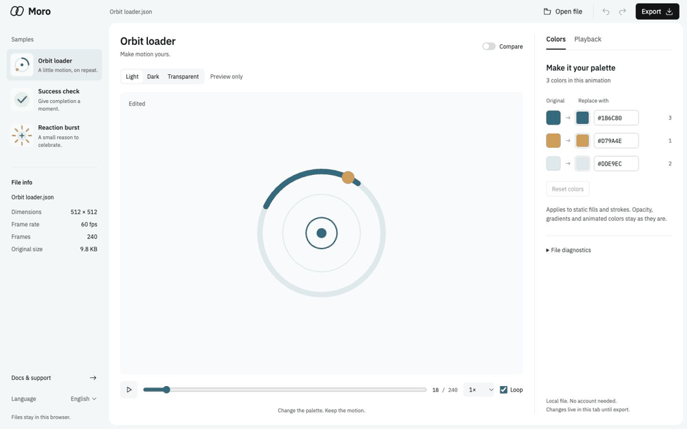

# Moro

Create shape-based Lottie animations, or recolor existing files, entirely in your browser. A local-first, account-free workbench built with React and TypeScript.



The preview is captured from the real local workbench, not a UI mockup. Two original product-motion showcases join the three essential samples. See [showcase provenance](docs/SHOWCASE-ASSETS.md) and [browser regression checks](docs/E2E.md).

**Try locally:** [Moro workbench](http://127.0.0.1:4173/) · [Creator](http://127.0.0.1:4173/create) · [Docs](http://127.0.0.1:4173/docs)

Source: [kimyoungwopo/moro](https://github.com/kimyoungwopo/moro). No public hosted demo is deployed. Moro is a working name.

## Quick start

Node.js 22.13+ is required; this creator integration was validated on Node 22.23.0.

```sh
npm ci
npm run dev
```

Open `http://127.0.0.1:4173/`. For the production build:

```sh
npm run build
npm run serve
```

Stop a prior server on that port before starting another, or use `PORT=4174 npm run serve`. The server binds to loopback only. The static build supports `/`, `/docs`, `/create`, `/rig` and `/studio`; other hosts must map these deep links to `index.html`.

## Create an animation

Open `/create` for a blank canvas. Add a rectangle or ellipse, set an X keyframe at frame 0, move to frame 60, and change X position. Play the actual Lottie preview, then **Export Lottie**. **Save project** keeps the editable `.moro.json`; **Open project** restores it. Exported animation JSON and editable projects are deliberately different formats.

The creator supports layers, drag positioning, undo/redo, five transform tracks (X/Y/scale/rotation/opacity), four named easing curves and a real frame/keyframe timeline. It exports shape-only, expression-free JSON. Arbitrary imported Lottie files are not converted into fully editable creator projects.

Agents and script users can start with the [authoring skill](skills/lottie-authoring/SKILL.md), [design rubric](docs/creator/AUTHORING-DESIGN.md), [source map](docs/creator/REFERENCES.md) and three original [editable examples](examples/authoring/). From the repository root:

```sh
node scripts/moro-create.mjs --input examples/authoring/loader/project.moro.json --out loader.generated.json
npm run agent:check
```

The CLI refuses overwrites and treats input as data, not executable code. The skill is repository guidance, not an automatically installed global agent hook. See [creator validation](docs/creator/VALIDATION.ko.md) for evidence and limits.

## Bring your own AI

Creator's optional **AI assistant** connects to an installed **Codex CLI or Claude Code** through a Rust loopback bridge. The official CLI owns login; Moro does not collect tokens or ask for an API key. **New motion** sends only your consented brief and visible display-size context. **Refine current project** additionally sends a project snapshot only after separate explicit consent (1–20 layers, at most64KiB). Results stay validated proposals until explicit Apply; structural changes are listed, and a changed source document blocks contextual Apply. One Undo restores the previous project. Existing CLI account billing/quota applies.

**Motion library** opens genuine previously AI-generated examples without an AI call. Save current work or an untouched AI proposal locally in IndexedDB, then reopen it later. Up to12 motions are stored per browser/origin; a full library rejects new saves instead of evicting old work. Nothing is auto-saved, and clearing site data removes the library. Keep project-file backups.

Review proposals in the actual Lottie player before applying: seek frames, play/pause, and inspect at64/128/512px. Bounded numeric warnings highlight clipping, tiny/faint elements and loop endpoint mismatches; they are **not artistic approval**. Craft references are included in the isolated planner input rather than relying on the model to read repository files. See [verified quality repairs and limits](docs/ai/QUALITY-FIX.ko.md) and the [design-guided rounded checks / target-sized badge results](docs/ai/DESIGN-QUALITY-RESULT.ko.md).

```sh
npm run build
npm run ai:build  # requires Rust/Cargo
npm run ai:serve # then open port 4174, /create
```

The normal static/dev server remains manual-only. The bridge currently targets POSIX/macOS/Linux, not Windows; macOS was tested. A live Codex generation → Apply → export → independent playback → Undo was verified. **Claude connection** is available beside the Claude provider controls in Creator, Quality lab, Rig and Studio: explicitly refresh CLI-reported status, confirm a visible official-CLI Terminal login on macOS, or copy the fixed manual login command. Moro never receives authentication codes or stores credentials. A terminal handoff or cached CLI login is **not** proof of successful account approval or live inference; the user completes the official browser/Terminal flow. See [Claude login and privacy boundaries](docs/ai/CLAUDE-LOGIN.ko.md) and [setup, verified layers and limitations](docs/ai/USAGE.ko.md). No hosted AI service or public deployment is included.

## Quality lab: bounded candidate review

Open **Quality lab** in Creator while using the Rust bridge. Choose a provider, brief, domain and display size; **Check capabilities** makes no model requests. A separate checkbox authorizes up to **seven official CLI requests** for one fixed base → two guidance proposals → two candidate probes → composed guidance → final proposal run. Account billing/quota applies. No automatic retries, current-project upload or lesson injection.

Review four project candidates manually in the real Lottie player, inspect structural differences and download the local report. No candidate is an automatic winner, and successful parsing is not artistic approval. Explicit **Apply reviewed candidate** is one edit with one Undo. A changed editor document blocks adoption, unchanged proposals consume no Undo, and cancellation retains the shared admission slot until cleanup finishes. High-quality human characters remain blocked before any Quality lab provider call: this seven-stage pipeline still uses v1. Rig lab's separate experimental v2 AI generation supports paths/groups/pivots but does not establish human-design approval.

See [app integration contract](docs/ai/HARNESS2-APP-CONTRACT.md) and [verified app integration](docs/ai/HARNESS2-APP-RESULT.ko.md). The native browser acceptance uses an explicitly configured fake protocol executable, not model inference. To exercise it after building the Rust binaries:

```sh
cargo build --manifest-path bridge/Cargo.toml --locked --bins
MORO_NATIVE_HARNESS_E2E=1 npm run test:e2e
```

## Rig lab: local cubic paths and articulated motion

Open `/rig`, or choose **Rig lab** from Creator. This separate local-first v2 editor supports editable cubic vertices/tangent handles, transform-only group parenting, static local pivots, five transform tracks, immutable Undo/Redo, editable-project save/reopen and expression-free Lottie export. Canvas drags use inverse parent/node world transforms. Importing a v1 COPY is explicit and does not modify the original; v2 projects are not accepted by the v1 editor. The optional v2 AI flow sends only the consented brief, never your current project or repository.

Groups do not inherit opacity. Preserve-world reparent/pivot operations reject unsupported animated transformations rather than silently baking a single pose. A project that fits editable-file limits may exceed export-complexity limits: the editor preserves the project, shows the error and still allows saving it. Manual Play is explicit and starts paused, including reduced-motion mode.

On the Rust bridge, choose **AI generate v2**, write a brief, consent, then **Generate proposal → Confirm one AI request**. Opening/checking installed CLIs sends no model request. The official CLI returns a data-only v2 proposal under the strict native validator; inspect its independent paused Lottie preview before **Apply proposal**. A changed document, active gesture, identical result, invalid project or exceeded export budget cannot replace your work. Apply is one Undo. v1, v2 and Quality lab share one server-side admission slot; no automatic retries or fallback. Account billing/quota applies.

The native read-only validator is `moro-validate-v2 --input FILE`. v2 AI is experimental object-motion generation, not automatic rigging, human-design approval, SVG import, path morphing or in-app MP4 export. See the [original local v2 contract](docs/creator/ENGINE-V2-CONTRACT.md), [manual technical demo](docs/creator/ENGINE-V2-RESULT.ko.md) and [separate v2 AI contract](docs/ai/ENGINE-V2-AI-CONTRACT.md). The manual lamp is not AI-generation evidence. A separate [actual one-request v2 AI result](docs/ai/ENGINE-V2-AI-RESULT.ko.md) and its untouched [editable tulip example](examples/authoring/ai-tulip-v2/) document the live generation → preview → Apply → save/export provenance.

## AI Studio: design-first ProjectV3

Open `/studio` on the Rust bridge for **static style → reviewed key poses → motion → independent preview → explicit Apply**. Each generation has its own confirmation and provider consent; later stages separately disclose transmission of the accepted previous proposal. Nothing advances or retries automatically. Workflow acceptance is not the user's artistic approval. Empty/group-only/unpainted style scaffolds are rejected; actual visible quality and brief fulfillment still require review.

The separate editable ProjectV3 supports bounded custom cubic easing, independent X/Y scales, skew/axis, same-topology cubic path morph, static local add/subtract/inverted masks and animated path trim. Selected-layer controls, project save/open, Lottie export, one-step Undo/Redo and proposal downloads are connected. Inverted masks may generate internal vector-only precomps to preserve local-coordinate semantics. v1/v2 projects and routes remain separate and unchanged. No animated masks, group clipping, external assets, true 3D folding or built-in MP4 export is claimed.

Accepted static artwork and authored pose keys are locked across stages; the frontend additionally compares samples at every accepted pose. A changed editor revision invalidates old acceptance/Apply. The native prior-envelope limit is 65536 UTF-8 bytes, with a 131072-byte HTTP request limit; oversized continuation fails before transmission without truncating the saved proposal. Technical checks and the operator's subjective review records are separate, with no numerical aesthetic score.

See the [frozen data/consent contract](docs/ai/DESIGN-DIRECTOR-V3-CONTRACT.md), [research adoption matrix](docs/ai/DESIGN-RESEARCH-ADOPTION.ko.md), [actual generation and validation result](docs/ai/DESIGN-DIRECTOR-V3-RESULT.ko.md), and [reviewed guidance provenance](docs/ai/guidance/ATTRIBUTION.md). Static serving supports editing/preview/save; actual AI requires the Rust bridge and the user's own installed official CLI/account.

## Recolor an existing animation

1. Start with Parcel dispatch or Payment approved, try the three essential samples, or open your Lottie JSON.
2. Try Lagoon, Ember or Ink to remap the palette in one undo step, then fine-tune static colors with HEX inputs or the color picker. Presets use source-tone rules, not semantic/AI detection. A picker Apply is one undo step; Cancel restores the prior palette.
3. Enable Compare to view both versions at a shared frame. On mobile, switch Original / Edited without changing the playhead.
4. Export JSON, or download the matching JSON, React component and light-player type declaration.

React export uses `lottie-web@5.13.0`. Place all three files together, enable TypeScript `resolveJsonModule`, and import `MoroAnimation.tsx`. Autoplay, loop, speed, hover/focus and click/tap behavior live in the wrapper; JSON retains its source timing. All modes include a play button and respect reduced motion on initial load. See the [working generated example](examples/react/README.md).

## Support and preservation

- Static shape fill/stroke RGB changes, including nested groups and precompositions.
- Exact RGB grouping: negative zero normalizes to zero; different float values remain separate even if their displayed HEX matches.
- Alpha, opacity, animated colors, gradients, unknown fields and timing are preserved.
- Original download retains source bytes. Edited export operates on a copy; the player also receives a clone.
- Inputs: JSON up to 2 MB, 100,000 nodes, 64 nesting levels, 8192 px dimensions, 1–240 fps, 18,000 frames and 10 minutes. These are conservative local limits, not universal Lottie limits.
- External images/fonts, expressions and unsupported embedded image formats block preview and edited export. Embedded PNG/JPEG/WebP/GIF are allowed. Original download stays available.
- Not included: dotLottie, SVG import, unrestricted imported-path/text editing, native 3D, GIF/MP4 export or cloud persistence. Shape authoring is available in Creator; local cubic-path/rig authoring is available separately in Rig lab, not as unrestricted editing of imported Lottie.

## Local processing

Files are parsed in browser memory. Manual editing has no upload endpoint, external font request, telemetry or API key. The language preference and explicitly saved local-library projects are persisted in browser storage; tokens are not. Optional AI sends only what you consent to: brief/display size for new generation, plus the selected current-project snapshot for contextual refinement. No repository, preview or arbitrary file is uploaded. This is not offline inference; the official CLI manages authentication. Save locally or download an editable project before closing or refreshing; unsaved edits are not recoverable. The local production server also applies a same-origin content security policy.

## Development

```sh
npm run check              # lint, types, unit tests, builds, skill sync check
npm audit
npm run samples:generate   # regenerate the three essential samples
node scripts/generate-showcase.mjs # regenerate the two original showcase samples
npm run example:generate   # regenerate React files from the real exporter
npm run skill:sync         # refresh standalone skill after a production build
```

Source lives in `apps/web`, `packages/document-core`, `packages/creator-core`, and `packages/player-adapter`. Tests and original fixtures are in `tests` and `fixtures`. [Validation evidence and limits](docs/VALIDATION.md) distinguish automated checks, browser checks and untested physical-device behavior.

### Codex skill

The self-contained skill remains named `lottie-studio` and displays **Moro — Lottie colors**. It includes the built local editor, original samples, a standalone Node server, and deterministic recoloring CLI.

```sh
npm run build
npm run skill:sync
npm run skill:install
```

The installer refuses to overwrite an existing skill. Back it up first or pass `-- --dest /absolute/new-folder`. See [skill instructions](skill/SKILL.md).

## Contributing and license

See [CONTRIBUTING.md](CONTRIBUTING.md). First contributions: fixtures, translations, actionable file errors and accessibility. First-party code and starter animations are MIT licensed. Self-hosted IBM Plex fonts use SIL OFL; see [third-party notices](THIRD_PARTY_NOTICES.md) and `apps/web/public/licenses`.
